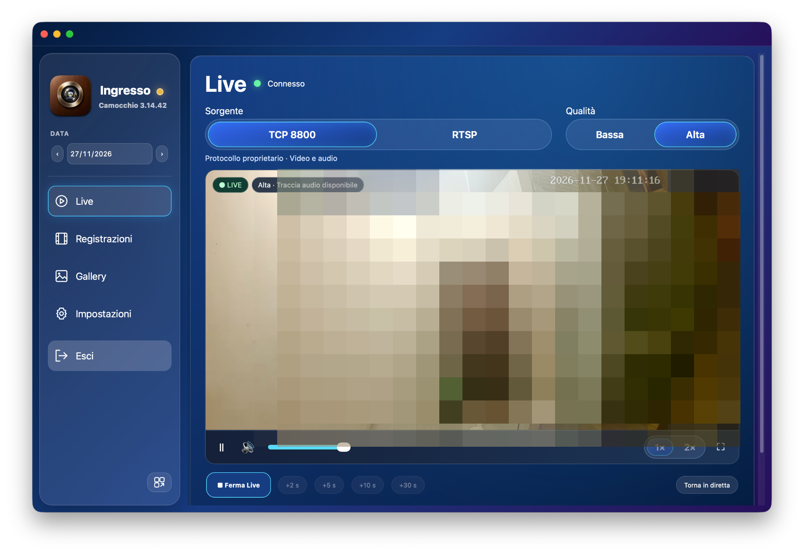
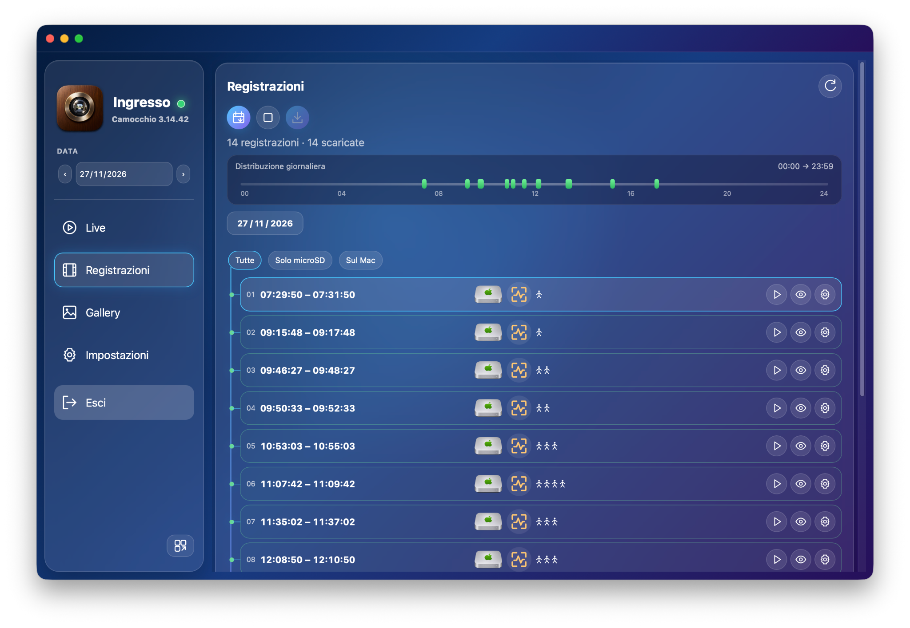
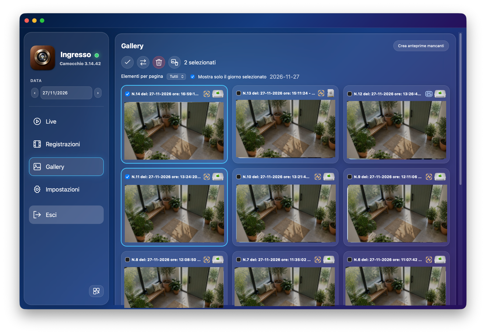
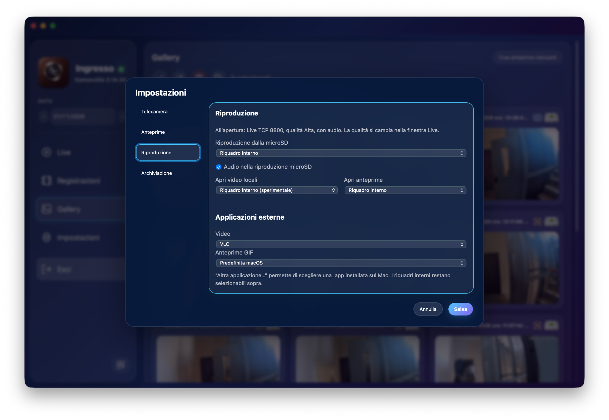
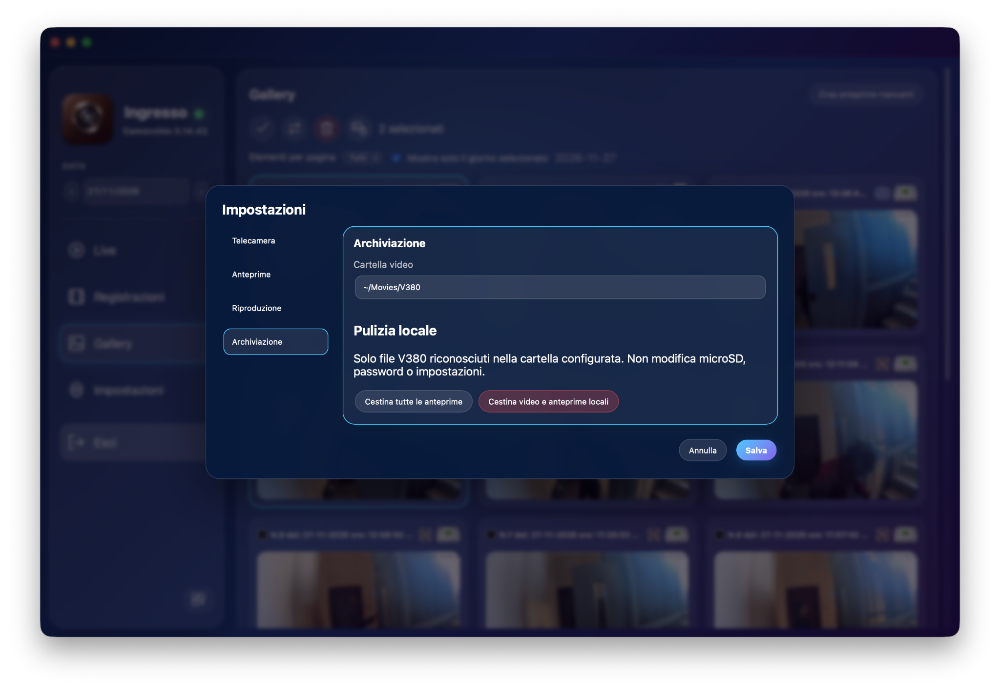

# Camocchio per Mac

**Guarda la diretta delle telecamere V380 compatibili e consulta le registrazioni microSD dal Mac, sulla rete locale.** Puoi rivedere un filmato senza scaricarlo, salvarlo sul Mac o sfogliare rapidamente la giornata con le anteprime.

Camocchio è un progetto indipendente, non ufficiale. La compatibilità dipende dal modello e dal firmware: non tutte le telecamere V380 espongono gli stessi flussi. La **3.14.42** è una candidata al collaudo; la baseline stabile resta **`mac-v3.14.39`**. Questo README riguarda macOS.

## Cosa puoi fare

- **Live con audio:** collegati in rete locale via **TCP 8800** con il protocollo proprietario, video HEVC e audio IMA ADPCM sui dispositivi compatibili. La 3.14.42 apre il Live in **Alta** con audio; puoi scegliere **Bassa** o passare manualmente a **RTSP**. Con RTSP la disponibilità dell’audio dipende dalla telecamera. Se il player blocca l’avvio automatico con audio, premi **Riproduci**.
- **Registrazioni:** consulta la distribuzione giornaliera, filtra tra **Tutte**, **Solo microSD** e **Sul Mac**, riproduci dalla scheda o scarica un filmato o le registrazioni della giornata. La correzione **−1 ora** aggiorna gli orari mostrati quando ricarichi l’elenco, senza modificare gli originali o rinominare i file già salvati.
- **Gallery e anteprime:** sfoglia video e GIF, anche per giorno. Genera anteprime uniformi o concentrate sui momenti con più movimento. **Crea anteprime mancanti** elabora gli MP4 locali senza sovrascrivere le GIF esistenti. Gli indicatori segnalano intervalli di movimento: **non contano le persone**.
- **Riproduzione e archiviazione:** scegli il player interno o un’app esterna e la cartella di archiviazione. Nel player interno puoi usare **1× / 2×** e salti di **2, 5, 10 e 30 secondi** quando il tratto è navigabile. Nel Live, **Torna in diretta** torna vicino al bordo del buffer. La pulizia locale non cancella le registrazioni dalla microSD.

## Schermate

Live, Registrazioni, Gallery e Impostazioni sono ricostruzioni dimostrative basate sull’interfaccia. La scena è fittizia, generata con Microsoft Copilot. Nomi, date, orari, indirizzo e identificativo sono di esempio: non usare i valori mostrati per configurare il dispositivo. Il pannello Archiviazione è un ritaglio della schermata originale, senza la Gallery sullo sfondo.

### Live



### Registrazioni



### Gallery



<details>
<summary>Impostazioni e archiviazione</summary>





</details>

## Scarica e configura

1. Apri **Releases**. Se disponibile, scarica `Camocchio_Mac_3.14.42_NATIVE.zip` dagli **Assets** della pre-release. Gli archivi automatici **Source code** contengono i sorgenti, non l’app compilata.
2. Estrai e apri `Camocchio.app`. Controlla nelle note della release l’architettura supportata e lo stato di firma e notarizzazione.
3. Collega il Mac alla stessa rete della telecamera. In **Impostazioni → Telecamera** inserisci l’IP locale, la porta, il Device ID e la password del tuo dispositivo. La password viene conservata nel **Portachiavi**. Consenti l’accesso alla rete locale se macOS lo chiede.
4. Apri **Live** per la diretta o **Registrazioni** per la microSD. La 3.14.42 ferma il Live prima di caricare l’elenco dalla scheda.

## Compila dai sorgenti

Lavora in una cartella locale fuori da iCloud, ad esempio `~/Developer`. Servono **Python 3.9 o successivo**, **FFmpeg** e **FFprobe**. Dal Terminale, nella radice dei sorgenti:

```bash
bash CREA_APP_MAC.command
```

Apri la build in `dist-native/Camocchio.app`. Per provare senza creare il bundle, usa `Avvia_V380_Mac.command` e apri l’interfaccia in **Safari** per il Live HLS.

## Privacy e limiti

- Camocchio si collega alla telecamera sulla rete locale: non occorre esporre la porta **8800** su Internet. Video e anteprime scaricati restano nella cartella configurata.
- Il Live ha un buffer. Latenza e sincronismo variano con telecamera, rete e player. Se segnali un problema, indica versione macOS, versione Camocchio, sorgente e qualità; non allegare credenziali, indirizzi reali, identificativi o riprese private.
